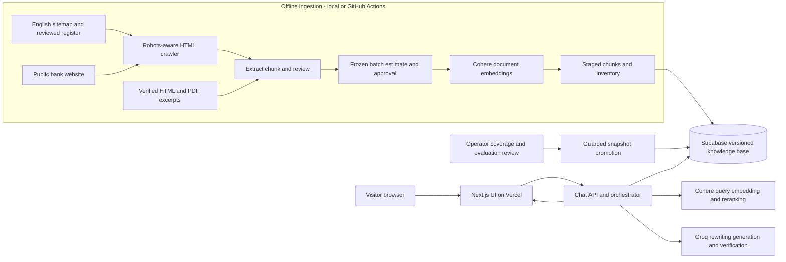
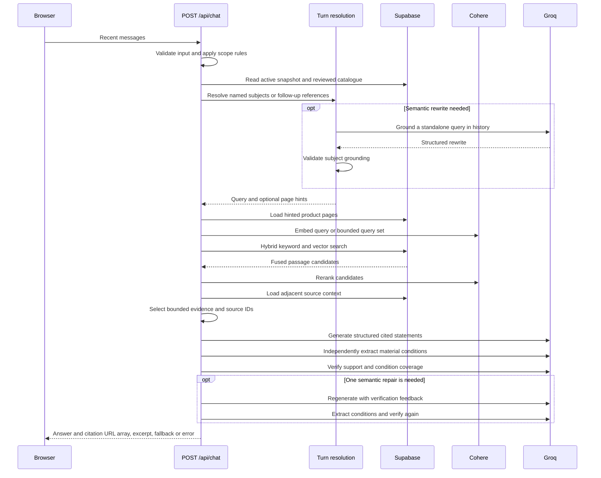
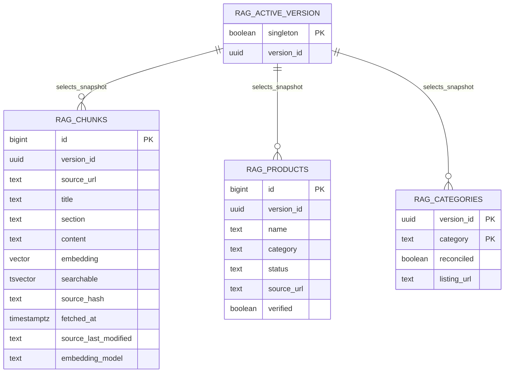

# Website RAG chatbot

A deployed Next.js application for questions about [Emirates NBD's public English website](https://www.emiratesnbd.com/en). It combines a reviewed product catalogue with retrieval-augmented generation, inline source links and conversational context. It cannot access customer accounts or perform banking transactions.

**Live application:** [website-rag-gamechange.vercel.app](https://website-rag-gamechange.vercel.app/)

**Status, 19 November 2026:** the application is deployed, but full assignment acceptance has not been established. The reviewed register contains 352 product/service records across 35 categories; 34 categories are reconciled and fund completeness remains unverified. Recent routing fixes are tested independently from live answer quality. Updating application code does not rebuild the active vector corpus.

## Contents

- [Run locally](#run-locally)
- [Configuration and stack](#configuration-and-stack)
- [High-level design: HLD](#high-level-design-hld)
- [Low-level design: LLD](#low-level-design-lld)
- [Data model and search](#data-model-and-search)
- [API contract](#api-contract)
- [Ingestion, chunking and freshness](#ingestion-chunking-and-freshness)
- [Guardrails and privacy](#guardrails-and-privacy)
- [Deployment and operation](#deployment-and-operation)
- [Verification and known gaps](#verification-and-known-gaps)
- [Repository map](#repository-map)

## Run locally

Requirements: Node.js **24.x**, npm, a Supabase project with pgvector, a Cohere API key and a Groq API key. The website serves a prebuilt index; starting the app does not crawl or embed the site.

```sh
npm ci
```

1. Copy [.env.example](.env.example) to `.env.local` and supply the four required server credentials listed below.
2. Execute [supabase/schema.sql](supabase/schema.sql) in the Supabase SQL Editor. The schema is rerunnable. Creating tables does not populate an index.
3. Use an existing populated database, or follow the [ingestion procedure](#ingestion-chunking-and-freshness) to stage and review a knowledge base before promotion.
4. Start the application:

```sh
npm run dev
```

Open [localhost:3000](http://localhost:3000). For a production build:

```sh
npm test
npm run build
npm start
```

A fresh database without an active snapshot returns the insufficient-evidence fallback. During development, `RAG_PREVIEW_VERSION` selects a populated staged snapshot for review; production ignores that variable and uses the active pointer.

## Configuration and stack

All credentials stay on the server. Do not use a `NEXT_PUBLIC_` prefix or commit `.env.local`.

| Variable | Purpose | Default / requirement |
|---|---|---|
| `SUPABASE_URL` | Database project URL | Required |
| `SUPABASE_SERVICE_ROLE_KEY` | Privileged server-side database access | Required |
| `COHERE_API_KEY` | Document/query embeddings and reranking | Required for model-backed retrieval |
| `GROQ_API_KEY` | Query rewriting, generation and verification | Required for model-backed answers |
| `COHERE_EMBED_MODEL` | Embedding model | `embed-english-v3.0`; vectors must have 1,024 dimensions |
| `COHERE_RERANK_MODEL` | Reranking model | `rerank-v3.5` |
| `GROQ_MODEL` | Generation and verifier model | `openai/gpt-oss-20b` |
| `RAG_PREVIEW_VERSION` | Staged snapshot UUID | Development only; empty by default |
| `RAG_DIAGNOSTICS` | Extra local evidence-ID/verifier diagnostics | Opt-in `true`, ignored in production |
| `VERCEL_GIT_COMMIT_SHA` | API revision header | Supplied by Vercel when available |

Embedding calls use `search_document` during ingestion and `search_query` during chat. The search function filters by the configured embedding model. Changing models requires a compatible staged corpus; changing vector dimensions also requires a schema migration. Editing an environment variable alone is not an embedding migration.

| Component | Implementation |
|---|---|
| UI and API | Next.js 16, React 19, TypeScript; Node.js runtime |
| Extraction | Cheerio HTML extraction, XML sitemap parsing, robots rules; separate PDF review tooling |
| Storage | Supabase PostgreSQL + pgvector + PostgreSQL full-text search |
| Retrieval | Catalogue-derived page hints, page-level lexical candidates, vector/keyword rank fusion, Cohere reranking |
| Answering | Groq structured generation, source-reference rendering, condition extraction and verification |
| Hosting | Vercel for the UI/API; GitHub Actions for manual ingestion and CI |

Exact dependency constraints and commands are in [package.json](package.json).

## High-level design: HLD

The offline ingestion path and online chat path share a versioned database. Crawling, document embeddings and snapshot promotion do not run inside a chat request.



- **Catalogue discovery** reads reviewed product/category records. It does not ask an LLM to invent a complete product list.
- **Factual answers** retrieve a small evidence set from the active snapshot, then generate and verify a response against those passages.
- **Follow-ups** use recent conversation text to identify the subject. Conversation history supplies context, not authoritative product facts.
- **Refresh** produces a separate snapshot. Only an explicit promotion switches production to it.

## Low-level design: LLD

### Chat request sequence

This diagram shows the factual-answer path. Input errors, deterministic refusals, catalogue discovery and genuine reference clarification can return before model-backed retrieval.



### Module responsibilities

| Module | Responsibility and boundary |
|---|---|
| [API route](src/app/api/chat/route.ts) | Validates the envelope, maps provider/service errors, adds request IDs on failures and a safe deployment revision header |
| [Chat orchestrator](src/rag/chat.ts) | Selects the active snapshot, routes discovery, resolves queries, retrieves evidence and coordinates generation/verification |
| [Catalogue turn resolver](src/rag/catalogue-turn.ts) | Uses catalogue-derived subject hints; supports singular/plural references and mention order without requiring a comparison keyword |
| [Product linker](src/rag/product-link.ts) | Weights name tokens against the catalogue and distinguishes local name spans; contains no per-product question aliases |
| [Rewrite validator](src/rag/turn.ts) | Checks model-proposed subjects against the conversation/catalogue before using a rewrite |
| [Retrieval](src/rag/retrieval.ts) | Page candidate scoring, source coverage, context neighbours and one shared evidence representation |
| [Providers](src/rag/providers.ts) | Server-side HTTP calls, embedding/rerank validation and structured generation schemas |
| [Structured answers](src/rag/structured-answer.ts) | Converts model source IDs into ordered citation markers and allowed URLs |
| [Verification](src/rag/verification.ts) | Validates exact source quotations and independently selected material conditions |
| [Repair](src/rag/repair.ts) | Allows at most one semantic repair, then verifies the replacement |
| [Excerpts](src/rag/excerpts.ts) | Provides bounded, attributed quotations from an identifiable source when possible |
| [Guardrails](src/rag/guardrails.ts) | Handles explicit account actions, narrow unrelated requests and unsupported personal decisions |
| [Inventory](src/rag/inventory.ts) | Formats reviewed categories and separates unknown availability from active records |

### Query and evidence contracts

1. For named-product questions, the original public question remains the primary embedding and reranking input. Catalogue matches are retrieval hints, not a requirement that the wording match a known title.
2. Up to four search queries are used. Supplemental product queries retain the original question; grounded follow-ups add the missing subject. Unsupported personal decisions can be separated from a supported public subquestion.
3. The SQL function obtains up to 50 lexical and 50 semantic candidates, combines their ranks, and returns 30 per search call by default.
4. Hinted product pages are loaded with a limit of 200 chunks per source. Page scoring retains introductory and query-relevant blocks. Context from up to eight top-ranked source candidates is also loaded, bounded at 200 chunks per source.
5. Evidence selection reserves source coverage for hinted products when ranked passages exist, then adds ranked passages and compatible section neighbours. It selects at most ten passages with a nominal **12,000 content-character** budget. This is not a token limit: titles, headings and request/schema overhead increase the actual provider input.
6. The generator returns statements with source IDs and explicitly unresolved parts. Application code renders `[1]` markers and a separate URL array; the UI turns markers into inline links.
7. Verification checks source quotations against the same title/heading/body representation supplied to generation. Independently extracted conditions must each be accounted for. This remains model-assisted verification, not a correctness proof.
8. A failed support/completeness check permits one semantic repair. Provider transport errors are not automatically retried. When applicable, an attributed excerpt can be returned; otherwise the app gives an insufficient-evidence response or a typed service error.

### Model calls and quota

| Path | Cohere requests | Groq requests |
|---|---|---|
| Catalogue list or deterministic refusal | 0 | 0 |
| Factual answer with no rewrite/repair | 1 embedding batch + 1 rerank | 3: draft, condition extraction, verification |
| Answer with one complete repair cycle | Same retrieval requests | Up to 6 |
| Optional conversational rewrite | No additional retrieval request by itself | Adds 1, up to 7 overall |

Counts describe the code path, not measured billing for every request. A request can exit earlier. Multiple query texts can share one embedding request. Free-tier access is quota-limited; switching browser or recording machine does not change the provider account quota. There is no shared response cache or application-level token-budget scheduler in the current code.

## Data model and search

[supabase/schema.sql](supabase/schema.sql) creates four public tables. Their `version_id` fields associate records with a snapshot; the diagram shows logical relationships, **not SQL foreign-key constraints**.



- `rag_active_version` has a singleton row pointing to production's selected snapshot. Historical/staged rows remain stored under their own versions; the diagram does not imply they belong to the active snapshot.
- `rag_chunks.embedding` is `vector(1024)`. `searchable` is a generated English full-text vector over title, section and content, with a GIN index.
- `hybrid_search` filters the selected snapshot and embedding model, then combines lexical and cosine-distance ranks using **RRF = 1/(60 + lexical rank) + 1/(60 + semantic rank)**, omitting the missing contribution when a branch has no match.
- The checked-in schema uses exact vector ordering. It does not create HNSW or IVFFlat indexes. Their value should be determined by retrieval/latency measurements before adding them; existing live-database customisations are not assumed here.
- `replace_staged_inventory` validates the staged snapshot, requires indexed source URLs, and atomically replaces its products and category coverage. Active inventory cannot be overwritten through that function.
- RLS is enabled. Anonymous/authenticated client access to these tables and RPCs is revoked; the application uses the server-only service role.

## API contract

### `POST /api/chat`

```json
{
  "messages": [
    {"role": "user", "content": "What are the fees for these two products?"}
  ]
}
```

The server accepts at most 12 messages, with roles `user` or `assistant`; each message must contain 1–5,000 characters and the last must be a user message. The handler rejects a declared `Content-Length` over 70,000 bytes or a decoded body over 70,000 characters. This is a non-streaming JSON endpoint.

Successful response shape:

```json
{
  "answer": "A source-supported explanation [1]",
  "citations": ["https://www.emiratesnbd.com/en/example-source"]
}
```

The URL above illustrates the format; it is not a product source. Clarifications, refusals and insufficient-evidence answers also use HTTP 200 and can have an empty citation array. HTTP 200 alone is not an answer-quality pass.

| Status | Meaning |
|---|---|
| `400` | Invalid JSON, history, message or final role |
| `413` | Request too large |
| `429` | Provider quota/rate limit; includes `provider_rate_limit`, a request ID, and `retryAfter` / `Retry-After` when known |
| `502` | Other upstream HTTP/network failures, including a provider rejecting a structured-output request |
| `503` | Generic knowledge-service failure, such as unavailable configuration/database/search |
| `504` | Provider timeout |

Provider errors use `{error, code, status, requestId, retryAfter?}`. Other service errors use `{error, requestId}`. `X-App-Revision`, when Vercel provides a valid commit SHA, identifies the serving revision. The route declares `maxDuration = 300`; individual provider HTTP calls have 45-second timeouts. The hosting plan/configuration must support the route duration. There is no request-wide deadline budget yet; multiple sequential 45-second calls can exceed the overall function allowance.

## Ingestion, chunking and freshness

### Prepare, review, stage, promote

The assigned origin is `https://www.emiratesnbd.com`; this is not an unrestricted arbitrary-site crawler.

```sh
# Validate the saved English sitemap.
npm run inspect:sitemap -- pipeline/sitemap-en.xml

# Crawl and calculate the frozen embedding estimate; no model calls.
npm run build:kb -- pipeline/sitemap-en.xml --estimate-only

# After reviewing and approving the printed fingerprint, stage this exact batch.
npm run build:kb -- pipeline/sitemap-en.xml --batch-id=<approved-fingerprint>
```

The last command sends document text to Cohere and writes a staged Supabase snapshot. It does not activate that snapshot. Without `--estimate-only` or an approved fingerprint, interactive local runs ask for confirmation before embedding; noninteractive runs require the approved fingerprint. Use `--inventory=<reviewed-register-path>` to replace the bundled reviewed register.

Preparation combines the saved sitemap and reviewed product URLs, prioritises product/support pages, checks robots rules and restricts redirects to the allowed origin. Sitemap fetches have a 16 MiB body limit; HTML fetches have a 5 MiB limit and 20-second fetch timeouts. The crawler normally pauses one second between pages and records failed, blocked, unsupported and unverified results in ignored `data/` artifacts. Some pages outside the product/support scope are audited for links rather than indexed as text. The crawler does not execute client-side JavaScript.

Extraction keeps headings, paragraphs, lists and reviewable tables, while removing navigation, scripts, testimonials, calculator widgets and email addresses. Default chunks are **1,400 characters**, merging compatible blocks within a section. Long prose splits on sentence boundaries; oversized sentences, FAQs and tables go to review instead of being split blindly. Unverified HTML tables and associated table-dependent prose are excluded by the current extractor/indexer. Only explicitly verified HTML/PDF excerpts are eligible for the supplemental reviewed-text path.

The indexer:

1. Requires the current extractor version and reviewed-source coverage.
2. Fingerprints the frozen text batch and model, reports request/character counts and excluded material.
3. Embeds up to 96 texts per batch with title and section context.
4. Stores the embedding model, content hash, source URL and available freshness metadata.
5. Checkpoints successful uploads and uploads the reviewed inventory to the staged snapshot.

For detailed repair, PDF/table review and standalone commands, see [README.ingestion.md](README.ingestion.md) and [data.example](data.example/README.md).

After coverage checks and model-backed evaluation, substitute the reviewed UUID into [supabase/promote.sql](supabase/promote.sql) and execute it as a privileged operator. Its guards require chunks, verified inventory and reconciled categories, with an explicit accepted exception for `funds`. The exception keeps fund completeness unverified; it does not satisfy a literal all-products requirement. Answer-quality acceptance is an operator review, not an automated SQL check. A rollback changes the pointer back to a retained, reviewed snapshot.

### Freshness: implemented versus proposed

**Implemented:** source timestamps/last-modified metadata when available, content hashes, separate snapshots, manual refresh and guarded promotion. GitHub ingestion is manually dispatched. The saved English sitemap must itself be refreshed when discovery changes.

**Not implemented:** scheduled recrawling, ETag/conditional fetches, an incremental changed-page-only embedding pipeline, deletion/tombstone handling and automated freshness alerts. Fetching a page successfully does not prove a rate or product is still current. Extractor version 4 is committed, but the active corpus has not yet been rebuilt and promoted with it.

## Guardrails and privacy

- Explicit account-action requests are declined. The app has no customer-account integration or transaction tools.
- Public facts can be answered separately from unsupported personal credit decisions or guaranteed personal investment returns.
- Early unrelated-request detection is deliberately narrow; remaining scope decisions rely on evidence and model instructions. It is not a universal intent classifier.
- Messages and passages are treated as untrusted input. Generated claims must reference allowed source IDs; verification checks quotation membership and material-condition coverage. These checks reduce risk but do not guarantee that the model identified every relevant condition.
- Chat is held in browser memory, with at most the latest 12 messages sent to the API. It resets on reload/new conversation and after 15 minutes of inactivity. Conversation text is sent to configured providers as needed; their policies still apply.
- The application does not persist conversation transcripts in Supabase. Production diagnostics record outcome/count metadata and safe provider-error identifiers; optional local diagnostics include database passage IDs and verifier failure labels.
- The API is public and has no application-level authentication, per-user rate limiter or distributed quota queue. These remain operational hardening work, rather than features claimed by this demo.

## Deployment and operation

**Vercel:** connect this repository as a Next.js project, use Node 24, and configure the server variables above. [vercel.json](vercel.json) runs `npm ci` and `npm run build`. Production reads the active database version; ingestion does not run in a Vercel request. Confirm provider/hosting quotas and function-duration support for the chosen accounts.

**GitHub CI:** [Application checks](.github/workflows/ci.yml) runs `npm ci`, tests and the production build on main pushes and pull requests without model credentials.

**GitHub ingestion:** [Knowledge base](.github/workflows/knowledge-base.yml) supports manual `prepare` and `stage` phases on the default branch, with one ingestion run at a time and a 180-minute job limit. Preparation saves a seven-day crawl artifact without provider credentials. Staging requires a successful prepare artifact from the exact same commit/workflow, its run ID and the approved 64-character batch fingerprint. Configure Actions secrets `COHERE_API_KEY`, `SUPABASE_URL` and `SUPABASE_SERVICE_ROLE_KEY` yourself. `GROQ_API_KEY` is needed by the deployed chat service, not the ingestion job.

See [deployment setup](docs/deployment.md) for the full operator workflow. Inspect checkpoints before resuming a failed embedding upload; a database success followed by a lost acknowledgement makes a blind retry unsafe. Application rollback and knowledge-base rollback are separate operations: revert/redeploy code for the former, restore a reviewed snapshot pointer for the latter.

A provider-free smoke check can POST `{}` to `/api/chat`: expect 400 and inspect `X-App-Revision`. This checks the serving code, not retrieval or answer quality. A real product/follow-up test consumes provider quota and must be evaluated separately.

## Verification and known gaps

As of the routing fix introduced in `b26cbfa`:

| Evidence | Result | What it establishes |
|---|---|---|
| Automated tests | 89 passing tests, including a 56-case phrasing matrix | Local contracts, routing, citation/verification behavior and simulated pipeline wiring |
| Frozen routing comparison | 16/56 correct product sets before; 56/56 after, across eight catalogue families | Entity resolution and intact query payloads, not live answer accuracy |
| Production build and CI | Passed | The application compiles and packages |
| Historical 15-question live evaluation | 13 pass, one partial, one fail, on an earlier revision | Recorded pipeline behavior for that frozen run |
| Latest recording attempts | Cited Wakala excerpts, follow-up, discovery/refusals succeeded; comparison hit provider quota | Observed deployed responses and an unresolved operational limitation |

The [historical evaluation](docs/submission/final-evaluation.md), [category reconciliation](docs/submission/category-reconciliation.md) and [coverage CSV](docs/submission/category-coverage.csv) retain failures and coverage exceptions. They are not fresh acceptance reports for every subsequent code revision. The routing fix and its causes are described in [conversation-routing notes](docs/conversation-routing-2026-11-19.md).

### How this compares with larger RAG systems

The saved corpus is on the order of thousands of chunks. We have not established vector-store capacity as the cause of the observed failures. Much larger systems still retrieve a bounded evidence set; they do not send the full corpus to the generator. This implementation already has hybrid search, rank fusion and reranking.

The remaining priorities are:

1. **Corpus reliability:** rebuild and review the improved extraction, preserve table/qualification context and resolve coverage exceptions before promotion.
2. **Retrieval evaluation:** maintain a held-out set with expected source pages and required conditions. Measure candidate recall, ranked source coverage and answer correctness separately. The 56-case routing matrix is only one layer.
3. **Conversation and metadata:** consolidate subject state, improve elliptical follow-ups, and represent product segment, applicability and source relationships explicitly. Current state is recent message text plus catalogue matching/validated rewrites.
4. **Evidence sufficiency:** calibrate what counts as enough evidence for each requested part. Current selection accepts positive reranker scores; no evaluated confidence threshold or retrieval-quality SLA is claimed. Persisted parent/child section relationships and calibrated selective retrieval expansion are future improvements; current neighbour expansion is a heuristic based on row order and section labels.
5. **Runtime cost and quota:** measure prompt tokens and latency per stage, introduce appropriate caching/admission control, and compare simpler verified-answer paths. Repeated model judgments add cost and can still be wrong; changing the generator alone cannot repair missing evidence.
6. **Freshness and operations:** automate reviewed refreshes, track deletions and expose stage-level quality/cost metrics before increasing traffic or corpus size.

Research sources and measured-versus-hypothesised gaps are collected in [architecture research notes](docs/rag-architecture-gap-research-2026-11-19.md). Proposed improvements in this section are not implemented features.

## Repository map

| Path | Contents |
|---|---|
| `src/app/` | Chat UI and API route |
| `src/rag/` | Routing, retrieval, providers, guardrails, citations, verification and repair |
| `src/ingest/` | Sitemap/crawl, extraction/chunking, review, indexing and inventory tools |
| `supabase/` | Rerunnable schema, search/inventory functions and guarded promotion |
| `pipeline/` | Saved discovery inputs |
| `test/` | Unit/regression tests and a simulated chat-pipeline integration test |
| `docs/submission/` | Reviewed register, coverage and historical evaluation artifacts |
| `.github/workflows/` | CI and manually dispatched ingestion |
| `data/` | Ignored local crawl/index artifacts and checkpoints |

AI assistance was used for implementation, regression tests, ingestion tooling, evaluation, research and preparation of documentation/submission materials.
