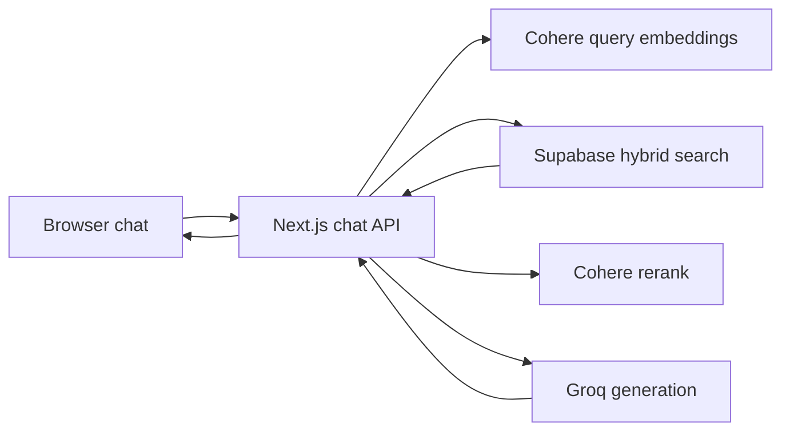
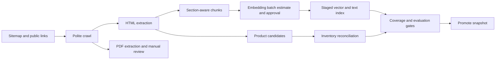
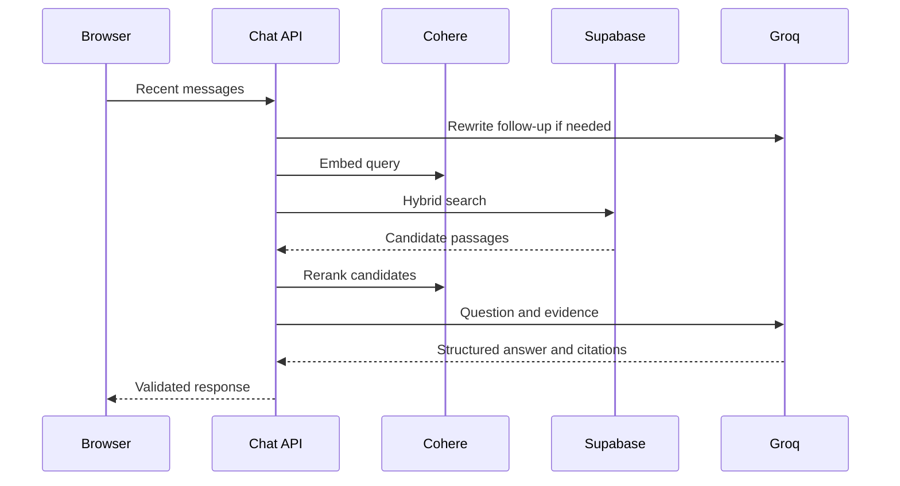

# Website RAG chatbot — technical draft

> The current six-page report is submission/website-rag-technical.pdf. The register has 352 offerings across 35 categories, with 34 reconciled and fund completeness unverified. GPT-OSS 20B is the default. The final fifteen-question evaluation passed thirteen cases, with one partial answer and one failure. See submission/final-evaluation.md.

## Assumptions and scope

The system answers questions about the public English pages of the assigned bank. Its users are reviewers asking product facts, discovery, comparisons and follow-ups. It cannot access accounts, initiate payments or provide personalized financial advice. Public sources can change, so answers represent the indexed snapshot and include links to the original pages. Personal data and account credentials should not be entered.

## High-level design

The Next.js server holds provider credentials and sends selected evidence to the generator. Conversations are held in browser memory for up to 15 minutes of inactivity and are not deliberately persisted in the application backend. Provider and platform policies still apply to data transmitted to them.

## Data pipeline

The saved sitemap contains 4,578 unique URLs but is not proof of product coverage. The crawler checks robots.txt, prioritizes product/support pages and records extraction failures. Product candidates require manual reconciliation against category listings. Extracted PDF text and tables require source review; the present prototype does not automatically index reviewed PDFs. A chunk carries the source URL, page title, section, text and embedding. Staged versions can be promoted after checks. Refresh is a manual rebuild; scheduled and incremental refresh are future work.

## Low-level design

The browser sends `POST /api/chat` with `messages`, an array of recent `{role, content}` records. The response contains `answer` and `citations`, or an `error` with a non-success status. History is bounded and only user/assistant roles are accepted. Follow-ups are rewritten to a standalone query. Query embeddings and PostgreSQL full-text search produce candidates; reciprocal rank fusion combines them and Cohere reranks them. The generator receives the selected passages as untrusted data. The application checks returned URLs against retrieved URLs before returning the answer.

The PostgreSQL model stores chunks with snapshot version, title, section, source and vector; a singleton identifies the active version. A separate product inventory records category, source, verification and availability status. The application does not store conversations or messages server-side.

## Risks and evaluation

Retrieval and prompts do not guarantee factuality or protect fully against prompt injection. Validate source claims and citation support in a representative test set, including numbers and conditions. Do not use unverified PDF table values. Compare inventory records with source listings and document missing categories or failed fetches. Rebuild shortly before the review and check conflicts against current sources. Handle unavailable providers with a retry message. Keep API keys server-side and do not log chat content.

**To complete before submission:** measured crawl and inventory coverage; the selected 15 questions, actual answers and source checks; model and quota observations; diagrams rendered into the final 4–6 page document; reviewer-ready demo and next steps.
